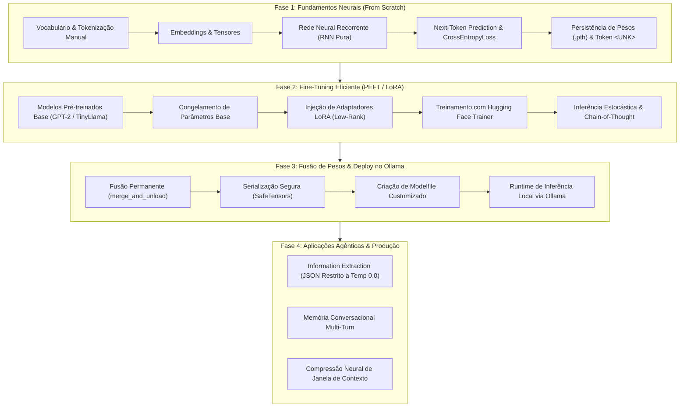

# 🧠 Laboratório de Engenharia e Aplicação de Modelos de IA Locais


Este repositório documenta uma jornada prática e aprofundada na **engenharia por trás dos grandes modelos de linguagem (LLMs)** e na **aplicação de modelos reais em ambiente local (100% offline e soberano)**.

O objetivo central deste estudo é desmistificar a "mágica" da inteligência artificial generativa, saindo do consumo superficial de APIs e compreendendo a pilha completa: desde a matemática de tensores, vocabulários e redes neurais recorrentes feitas do zero, passando pela técnica de **Fine-Tuning com LoRA (PEFT)**, fusão de pesos (*weight merging*), até a construção de **sistemas agênticos e de extração estruturada (JSON)** com motores de inferência modernos como o Ollama.

---

## 🗺️ Trilha de Aprendizado (Roadmap da Engenharia)

O estudo foi concebido em **4 fases progressivas**, simulando a evolução histórica e técnica da área de Processamento de Linguagem Natural (NLP) até as LLMs contemporâneas:



---

## 🔬 Detalhamento Técnico das Fases

### 1. Fundamentos Neurais e NLP "From Scratch"
Antes de manipular bilhões de parâmetros, é fundamental entender a mecânica básica:
- **Matemática Vetorial & Embeddings**: As palavras são mapeadas para inteiros (`vocab` / `itos`) e projetadas em espaços densos contínuos (`nn.Embedding`), permitindo que a rede aprenda relações de proximidade semântica.
- **Redes Neurais Recorrentes (RNN)**: Implementação em PyTorch puro de camadas recorrentes onde um estado oculto (`hidden_dim`) atua como uma "memória de curto prazo", transitando de token em token.
- **Treinamento Autorregressivo**: Aplicação do mecanismo de predição do próximo elemento (janela deslizante), cálculo de perda via `nn.CrossEntropyLoss` e calibração de pesos com `optim.SGD` e `optim.Adam`.
- **Tratamento de Vocabulário Aberto**: Criação do token especial `<UNK>` para lidar com termos nunca vistos em tempo de inferência, além de rotinas de autoalimentação de dados.

### 2. Fine-Tuning de Parâmetros Eficiente (PEFT / LoRA)
Treinar modelos fundacionais completos requer clusters massivos de GPUs. Para contornar esse gargalo, exploramos a técnica **LoRA (Low-Rank Adaptation)**:
- **Teoria Matemática**: Em vez de atualizar a matriz de pesos completa $W_0 \in \mathbb{R}^{d \times k}$, congelamos $W_0$ e introduzimos uma decomposição de baixo posto $\Delta W = B \cdot A$, onde $B \in \mathbb{R}^{d \times r}$ e $A \in \mathbb{R}^{r \times k}$, com $r \ll \min(d, k)$.
- **Economia Brutal de Recursos**: No modelo `TinyLlama (1.1B)`, congela-se a quase totalidade dos parâmetros, treinando apenas as matrizes de projeção (`q_proj`, `v_proj`) ou de atenção (`c_attn` no `GPT-2`), gerando adaptadores de apenas **1 MB a 10 MB**.
- **Controle de Geração**: Exploração de hiperparâmetros de decodificação (`temperature`, `top_p`, `repetition_penalty`, penalidade de repetição) e formatação de raciocínio via tags semânticas (`<pergunta>`, `<pensamento>`, `<resposta>`).

### 3. Fusão de Pesos (*Weight Merging*) & Deploy com Ollama
Adaptadores LoRA introduzem uma pequena latência em produção porque realizam computações paralelas. A solução de engenharia adotada foi:
- **Fusão Permanente**: Execução de `merge_and_unload()` para somar algebricamente os pesos aprendidos diretamente na matriz base original.
- **Padrão SafeTensors**: Exportação no formato aberto da Hugging Face, prevenindo ataques de injeção de código existentes no formato Pickle padrão do PyTorch e permitindo carregamento veloz via `mmap`.
- **Modelfile**: Encapsulamento do modelo fundido dentro do runtime Ollama com controle rígido de contexto (`num_ctx 4096`), temperatura e templates automáticos.

### 4. Sistemas Agênticos e Extração Estruturada
Com o modelo otimizado e rodando localmente, o laboratório avança para padrões de arquitetura de software:
- **Constrained Decoding (Geração Estruturada)**: Forçar a saída da LLM a respeitar esquemas JSON rígidos com `temperature=0.0`, viabilizando integração direta com bancos de dados relacionais e APIs de negócio (ex.: triagem industrial de equipamentos e categorização contábil de despesas).
- **Memória de Conversação Multi-Turn**: Manutenção do array de mensagens com papéis `system`, `user` e `assistant` via `/api/chat`.
- **Compressor Neural de Contexto**: Para evitar o estouro da janela de contexto (*context window overflow*), implementou-se uma rotina autônoma de sumarização factual: quando o histórico ultrapassa um limiar estipulado, as mensagens antigas são resumidas em background por um modelo analítico e reinjetadas no prompt de sistema, garantindo conversas infinitas sem perda de fatos cruciais.

---

## 📂 Mapa dos Módulos e Scripts

| Arquivo | Fase / Tema | Papel no Projeto | Tecnologias Principais |
| :--- | :--- | :--- | :--- |
| [primeira_ia.py](file:///media/elliasgomes/HD_1TB/apps/rodando_ia/primeira_ia.py) | Fase 1: Do Zero | Rede neural recorrente artesanal, embeddings, cálculo de loss e geração básica. | `PyTorch`, `nn.RNN`, `CrossEntropyLoss` |
| [primeiro_chat.py](file:///media/elliasgomes/HD_1TB/apps/rodando_ia/primeiro_chat.py) | Fase 1: Do Zero | Chatbot estruturado com tags `<pergunta>`/`<resposta>` e persistência de pesos em disco. | `PyTorch`, `optim.Adam`, salvamento `.pth` |
| [chatbot_unk.py](file:///media/elliasgomes/HD_1TB/apps/rodando_ia/chatbot_unk.py) | Fase 1: Do Zero | Chatbot com tratamento de token `<UNK>`, retreino dinâmico (`/ensinar`) e suporte a GPU. | `PyTorch (CUDA/CPU)`, Dataset iterativo |
| [conhecimento.py](file:///media/elliasgomes/HD_1TB/apps/rodando_ia/conhecimento.py) | Fase 2: LoRA | Configuração de adaptadores LoRA sobre o `TinyLlama-1.1B` e análise de memória economizada. | `peft (LoraConfig)`, `transformers` |
| [treinar_gpt2.py](file:///media/elliasgomes/HD_1TB/apps/rodando_ia/treinar_gpt2.py) | Fase 2: LoRA | Pipeline completo de fine-tuning usando Hugging Face Trainer com dataset customizado. | `transformers.Trainer`, `PEFT`, `GPT-2` |
| [chat_gpt2.py](file:///media/elliasgomes/HD_1TB/apps/rodando_ia/chat_gpt2.py) | Fase 2: LoRA | Inferência combinada: pluga os pesos LoRA no GPT-2 base para responder perguntas técnicas. | `PeftModel.from_pretrained`, `transformers` |
| [chat_tiny.py](file:///media/elliasgomes/HD_1TB/apps/rodando_ia/chat_tiny.py) | Fase 2: LoRA | Inferência de TinyLlama com LoRA, Chain-of-Thought e pós-processamento de guilhotina textual. | `TinyLlama`, `repetition_penalty`, `top_p` |
| [ollama.py](file:///media/elliasgomes/HD_1TB/apps/rodando_ia/ollama.py) | Fase 3: Fusão | Fusão permanente dos adaptadores LoRA no modelo base e exportação em `safetensors`. | `peft.merge_and_unload`, `safetensors` |
| [Modelfile](file:///media/elliasgomes/HD_1TB/apps/rodando_ia/Modelfile) | Fase 3: Deploy | Manifesto de compilação do modelo fundido dentro do runtime Ollama local. | `Ollama Modelfile`, Templates |
| [app.py](file:///media/elliasgomes/HD_1TB/apps/rodando_ia/app.py) | Fase 4: Aplicações | Engenharia de System Prompt rígido (regras arquiteturais de banco de dados SQL). | `Ollama API (/api/generate)`, `DeepSeek-R1` |
| [extrator_json.py](file:///media/elliasgomes/HD_1TB/apps/rodando_ia/extrator_json.py) | Fase 4: Aplicações | Triagem de manutenção industrial: converte relatos brutos em JSON tipado a temperatura zero. | `Qwen 2.5 1.5B`, Constrained JSON |
| [gerar_tabela.py](file:///media/elliasgomes/HD_1TB/apps/rodando_ia/gerar_tabela.py) | Fase 4: Aplicações | Extrator financeiro temporal: parse de linguagem natural para schemas de transação. | `DeepSeek-R1`, JSON Mode |
| [agente_memoria.py](file:///media/elliasgomes/HD_1TB/apps/rodando_ia/agente_memoria.py) | Fase 4: Agentes | Agente conversacional com retenção de contexto multi-turn via array de mensagens. | `Ollama API (/api/chat)` |
| [compactando_mensagens.py](file:///media/elliasgomes/HD_1TB/apps/rodando_ia/compactando_mensagens.py) | Fase 4: Agentes | Mecanismo de compressão neural: resumo em background de turnos antigos para liberar contexto. | `Multi-turn Chat`, Summarization Pipeline |
| [conhecimento.txt](file:///media/elliasgomes/HD_1TB/apps/rodando_ia/conhecimento.txt) | Datasets | Dataset sintético de instrução e diretrizes arquiteturais corporativas. | Formato `<pergunta> ... <resposta>` |
| [conhecimento_gigante.txt](file:///media/elliasgomes/HD_1TB/apps/rodando_ia/conhecimento_gigante.txt) | Datasets | Amplo corpus de dados de instrução em língua portuguesa para treino e vocabulário. | Corpus NLP em Português |

---

## ⚙️ Configuração do Ambiente e Execução

### 1. Pré-requisitos
- Python 3.10 ou superior
- Gerenciador de inferência local [Ollama](https://ollama.com/) instalado e rodando em sua máquina
- (Opcional, mas recomendado) GPU NVIDIA com suporte CUDA para acelerar os treinos e inferências

### 2. Configuração das Variáveis de Ambiente (`.env`)
Para manter o projeto seguro e modular, todas as credenciais, endereços locais e preferências de usuário foram centralizadas no arquivo `.env`.

Copie o modelo de exemplo:
```bash
cp .env.example .env
```

Edite o arquivo `.env` para ajustar conforme a sua máquina:
```ini
USER_NAME=Ellias
TRAINING_USER_NAME=ellias
TRAINING_USER_AGE=21

OLLAMA_BASE_URL=http://localhost:11434
OLLAMA_CHAT_MODEL=deepseek-r1:8b
OLLAMA_EXTRACTOR_MODEL=qwen2.5:1.5b
OLLAMA_COMPRESSION_MODEL=deepseek-v3.1:671b-cloud
```

> [!NOTE]
> Os scripts contam com um leitor automático e nativo de variáveis de ambiente. Caso instale o pacote `python-dotenv`, ele também será utilizado de maneira transparente.

### 3. Modelos Locais no Ollama
Baixe os modelos recomendados utilizados pelos scripts:
```bash
ollama pull deepseek-r1:8b
ollama pull qwen2.5:1.5b
```

### 4. Executando os Módulos Práticos

#### Teste dos Fundamentos (Do Zero)
```bash
python primeira_ia.py
python primeiro_chat.py
python chatbot_unk.py
```

#### Fine-Tuning e Teste com LoRA
```bash
# Executar o treinamento com LoRA sobre o GPT-2
python treinar_gpt2.py

# Conversar com o modelo adaptado
python chat_gpt2.py
```

#### Fusão de Pesos e Importação no Ollama
```bash
# 1. Funde os adaptadores LoRA no modelo base
python ollama.py

# 2. Registra o modelo no Ollama usando o Modelfile
ollama create meu-modelo-customizado -f Modelfile

# 3. Testa a IA no terminal
ollama run meu-modelo-customizado
```

#### Extração Estruturada e Agentes com Memória Dinâmica
```bash
# Extração de relatos mecânicos para JSON com Qwen
python extrator_json.py

# Agente com compressão neural de contexto em background
python compactando_mensagens.py
```

## 📦 Modelos, Pesos e Datasets (o que está ou não no Git)

O GitHub rejeita arquivos acima de 100 MB, então os pesos são tratados assim:

| Item | Tamanho | No Git? | Como obter / reproduzir |
| :--- | :--- | :---: | :--- |
| `meu_chatbot_gpt/` (LoRA sobre `gpt2`) | ~1.2 MB | ✅ Sim | Gerado por `treinar_gpt2.py` (r=8, alpha=16, `c_attn`) |
| `meu_chatbot_tinyllama/` (LoRA sobre `TinyLlama/TinyLlama-1.1B-Chat-v1.0`) | ~4.4 MB | ✅ Sim | Adaptador LoRA (r=8, alpha=16, `q_proj`/`v_proj`) |
| `conhecimento.txt` / `conhecimento_gigante.txt` | 2 KB / 1.7 MB | ✅ Sim | Datasets de treino no formato `<pergunta> ... <resposta>` |
| `meu_modelo_fundido/` (TinyLlama + LoRA, fp16) | ~2.1 GB | ❌ Não | Rode `python ollama.py` (precisa dos adaptadores acima + modelo base do Hugging Face) |
| `resultados_lora/` (checkpoints intermediários) | ~48 MB | ❌ Não | Gerados durante `python treinar_gpt2.py` (a cada 50 passos) |
| `chatbot_pesos.pth` (RNN do zero) | pequeno | ❌ Não | Gerado automaticamente ao rodar `chatbot_unk.py` / `primeiro_chat.py` |

Os modelos base são baixados automaticamente do Hugging Face na primeira execução. Para publicar o modelo fundido, a recomendação é hospedá-lo no [Hugging Face Hub](https://huggingface.co/) e referenciar o link aqui.

## 🔌 Integração Opcional com APIs Externas

[cliente_api.py](cliente_api.py) oferece uma chamada simples a Gemini ou OpenAI, configurada só pelo `.env` (`API_PROVIDER`, `GEMINI_API_KEY`, `OPENAI_API_KEY`):

```python
from cliente_api import perguntar
print(perguntar("Explique LoRA em uma frase."))
```

Os demais scripts continuam 100% locais. Variáveis `SUPABASE_URL` / `SUPABASE_KEY` já estão previstas no `.env.example` para uso futuro.

---

## 🛡️ Políticas de Segurança e Versionamento (.gitignore)

O repositório adota regras estritas de higiene de código e segurança de dados:
1. **Credenciais e Dados Pessoais**: Arquivos `.env` e variações locais estão no `.gitignore`.
2. **Arquivos Pesados de Modelos**:
   - `meu_modelo_fundido/` (~2.1 GB de pesos) e `resultados_lora/` (checkpoints temporários) estão explicitamente desconsiderados pelo versionamento para preservar o repositório leve.
   - Padrões de binários como `*.safetensors`, `*.pt`, `*.pth` e `*.bin` são ignorados, **exceto** os adaptadores LoRA finais leves (`meu_chatbot_gpt/` e `meu_chatbot_tinyllama/`).
3. **Pasta de Alinhamento (`duvidas/`)**: Contém anotações de design e perguntas de contexto sobre o projeto, protegida contra commits acidentais.

---

## 📌 Principais Aprendizados de Engenharia

1. **LLMs são Determinísticas na Base**: Uma rede neural é uma cadeia de multiplicações de tensores. A aparente "criatividade" decorre da amostragem estocástica sobre a distribuição de probabilidades dos tokens futuros.
2. **Eficiência de Parâmetros é o Futuro**: Adaptadores como LoRA viabilizam que modelos de ponta sejam personalizados em GPUs domésticas ou até CPUs, com frações mínimas de consumo de disco e VRAM.
3. **Engenharia de Contexto > Tamanho do Modelo**: Sistemas inteligentes dependem de como você gerencia o histórico de conversas. Técnicas de compressão neural e resumos contínuos são cruciais para contornar os limites físicos de memória das arquiteturas de atenção.
